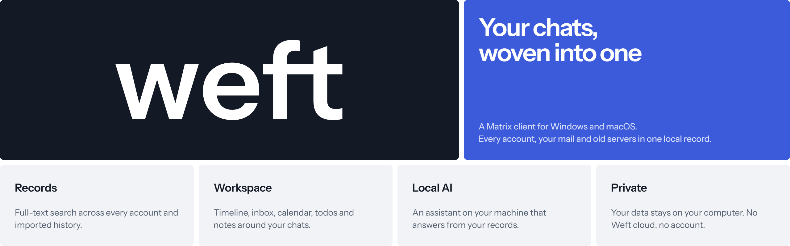

<p align="center">
  
</p>

<p align="center">
  <b>Your chats, woven into one.</b><br />
  A Matrix client for Windows, macOS and Linux that keeps every account, your mail and
  servers long gone in one searchable record on your own computer.
</p>

<p align="center">
  <a href="https://github.com/smilefx/weft-app/releases/latest"><b>Download</b></a> ·
  <a href="https://weft.lucaar.dev/">Website</a> ·
  <a href="https://github.com/smilefx/weft-app/releases">All releases</a>
</p>

---

## What Weft does

- **Search every chat at once.** Full-text search across every account, encrypted rooms
  and imported history included.
- **All your accounts, one list.** Sign in to as many homeservers as you have. When you
  use several Matrix servers that are not federated, link people and rooms across them and
  Weft shows them as one chat, with the right account for each message.
- **History from servers that shut down.** Import an Element export (JSON or zip). The
  messages slot into the room at their original time, attachments included.
- **Mail next to your chats.** Add an IMAP account, a local model sorts it into what needs
  a reply, which label it belongs to and what is spam.
- **Encrypted, keys backed up.** End-to-end encryption with cross-signing, key backup and
  recovery. Weft signs in as one more device, so Element and your phone stay in sync.
- **Everything around the chat.** A timeline that sums up what you missed, a calendar that
  finds dates in messages (and subscribes to `.ics` feeds such as a course timetable), a
  todo board, notes that quote what was said, and a page for every person.
- **From message to todo.** A small model on your machine reads new messages and suggests
  todos and events with a title, a date and a label. Nothing is added without you.
- **Warp, an assistant for your records.** Ask your chats anything: Warp searches, reads
  what matters and answers in a few sentences with numbered sources. It can propose todos,
  notes and replies, you decide what happens.
- **Privacy mode.** Sharing your screen in a lecture or a meeting? Privacy mode covers the
  open chat and hides previews in the chat list.
- **Make it yours.** Eight themes, nine accents, three message styles, adjustable density
  and corners, and a `user.css` that loads last and reloads as you save.
- **English or German**, for the app and everything the assistant writes.

## Your data stays on your machine

Weft is a service that runs inside the app on your own computer. Messages, imports, todos
and notes stay in your data folder. There is no Weft cloud and no Weft
account.

The assistant features use an inference server on your machine with an OpenAI-compatible
API, such as [Ollama](https://ollama.com). Without one, chats, search and the workspace work
as usual.

## Install

Download the installer for your system from the
[latest release](https://github.com/smilefx/weft-app/releases/latest):

| System                    | File                 |
| ------------------------- | -------------------- |
| Windows 10 and 11, 64-bit | `..._x64-setup.exe`  |
| macOS, Apple silicon      | `..._aarch64.dmg`    |
| macOS, Intel              | `..._x64.dmg`        |
| Linux, 64-bit             | `..._amd64.AppImage` |
| Debian and Ubuntu, 64-bit | `..._amd64.deb`      |

Weft keeps itself up to date: it checks shortly after it starts and every six hours,
downloads a signed update in the background and asks you to restart when it is ready.

**Windows says it protected your PC.** Weft is not signed with a paid certificate yet, so
SmartScreen warns on the first install. Choose _More info_, then _Run anyway_. Updates after
that do not warn. The installer needs no administrator rights.

**macOS will not open it.** Drag Weft to Applications and open it. If macOS refuses, open
_System Settings → Privacy & Security_ and choose _Open Anyway_. If it says the app is
damaged, run this once in Terminal:

```bash
xattr -dr com.apple.quarantine /Applications/Weft.app
```

**Linux.** Weft needs Ubuntu 22.04 or newer, or another distribution of that age. Make the
AppImage executable (`chmod +x Weft_*.AppImage`) and start it; it updates itself. The `.deb`
installs with `sudo apt install ./Weft_*_amd64.deb` and does not update itself: install the
next one. The tray icon needs AppIndicator support, which GNOME gets from its AppIndicator
extension.

## Coming soon

- **Container.** The same service in a container on your own server, with Weft in the
  browser.
- **Open source.** The source code of the app and the service, published here.

Watch this repository (_Watch -> Custom -> Releases_) to hear when they land.

## Report a problem or suggest something

Use [Issues](https://github.com/smilefx/weft-app/issues) in this repository, for the app
as well as the website. Search first, so if someone already reported it, add what you know
there.

For a bug, please include:

- your Weft version and your system (Windows, macOS on Apple silicon or Intel, or your
  Linux distribution),
- what you did, what you expected and what happened instead,
- a screenshot or the error text, if there is one.

Chats and mail are personal. Do not paste message content, tokens, passwords or exports
into an issue. Instead describe the problem in made-up words, and blur names in screenshots.

## Questions

**Do I need a Matrix account?** Yes. Any homeserver works, your organisation's or a public
one, with password or single sign-on. Mail is optional.

**Can I keep using other clients?** Yes. Weft signs in as one more device of your account,
so everything stays in sync with your other clients, encryption keys included.

**Where is my data stored?** In one file and a media folder inside your user data
folder. Back it up like any other file. Remove an account and its
data goes with it.

---

People, chats and mail on the website are made up. Matrix is an open standard of the
Matrix.org Foundation.
